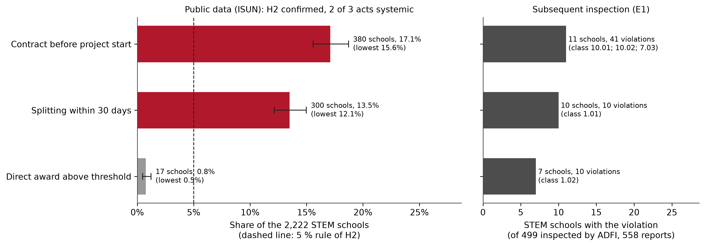
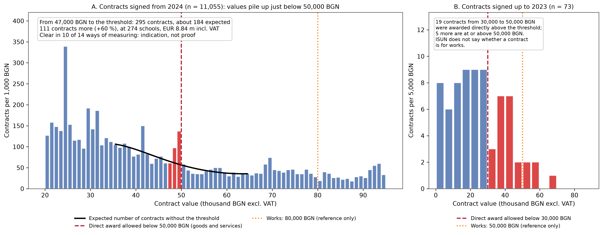
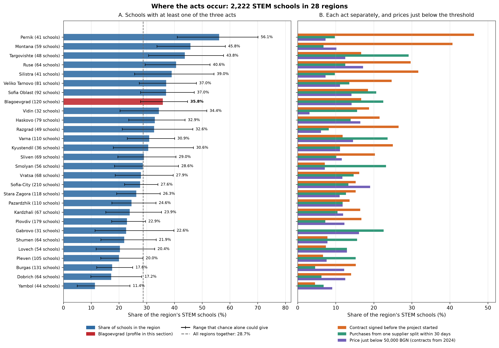
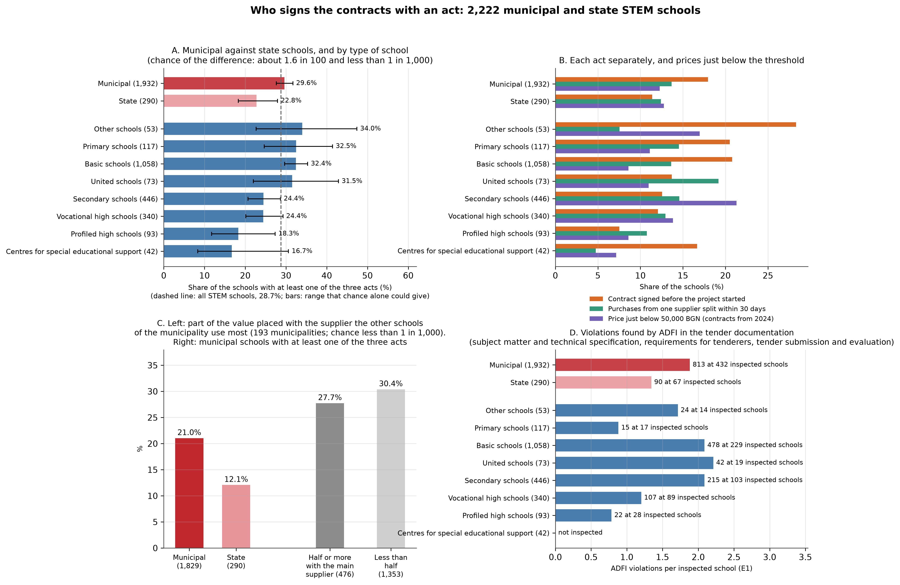

# Ex-Ante Financial Control Indicators in Public Procurement Data (BG-RRP-1.015 „School STEM Environment“)

*Indicators of ex-ante financial control in the ISUN open data on the contracts of the schools under procedure BG-RRP-1.015 "School STEM Environment" of the National Recovery and Resilience Plan, and their comparison with the violations found by the Public Financial Inspection Agency (ADFI)*

**An indicator is not a proven violation.** An indicator shows a commitment that the financial controller of the school had to check before signature. The names of legal entities and schools and their EIK/Bulstat are kept in the tables in `data/`, as they are public data in ISUN; the names of sole traders and natural persons are redacted. No school, municipality or person is accused of anything.

## Objective

The study measures in the ISUN open data of 2026-09-10 three acts of the school that its financial controller checks before the commitment is taken (Art. 13(3) items 1 and 3 of the Financial Management and Control in the Public Sector Act):

1. the contract is signed before the project started (`predated`);
2. purchases from one supplier are split within 30 days into contracts below the threshold whose sum reaches it (`split_30d`);
3. a contract is awarded directly although its value required a call or a procedure (`regime_mismatch`).

It then compares them with the violations that ADFI found in its inspection reports on the same schools, as classified in `adfi-violations-classification` at commit `c9bd90d`.

**Hypothesis H2.** Confirmed if at least two of the three acts have a lower bound of the 95 % Wilson interval of the share of schools above 5 % (N = 2,222 schools with a contract). The rule was fixed before the computation.

## Main results

| Question | Result |
|---|---|
| Coverage | 2,228 projects, 2,222 schools with a contract, 11,128 contracts; EUR 288.59 m with VAT, EUR 240.49 m without VAT; EUR 28.52 m (9.9 %) not yet paid |
| Schools with at least one of the three acts | 638 of 2,222 (28.7 %, at least 26.9 %); 1,403 contracts worth EUR 23.69 m with VAT |
| H2 | Confirmed: `predated` at 17.1 % of the schools (at least 15.6 %), `split_30d` at 13.5 % (at least 12.1 %); `regime_mismatch` at 0.8 % (at most 1.2 %) |
| Prices just below 50,000 BGN without VAT | 295 contracts against about 184 (+60 %); clear in 10 of the 14 ways of measuring, not strong enough to count as proof |
| ADFI | 180 of the 638 schools with an act inspected; a violation of the same act at 11; 458 never inspected |
| ADFI classification | The type of 1,130 of the 1,195 violations at STEM schools (94.6 %) is written in ADFI's own words; none of the 10 on direct award above the threshold |
| Where | From 11.4 % (Yambol) to 56.1 % (Pernik) of the schools of a region; 29.6 % at municipal against 22.8 % at state schools |

<p align="center"></p>
<p align="center"><b>Level 1 and H2: public data against the ADFI findings</b></p>

<p align="center"></p>
<p align="center"><b>Prices set just below the direct-award threshold</b></p>

<p align="center"></p>
<p align="center"><b>Where the acts occur: 28 regions and the profile of Blagoevgrad</b></p>

<p align="center"></p>
<p align="center"><b>Who signs the contracts: municipal and state schools, school types, and one supplier per municipality</b></p>

## Conclusions

1. The public data in ISUN cover the whole programme on 2026-09-10: 2,228 projects, 2,222 schools with a contract and 11,128 contracts worth EUR 288.59 m with VAT and EUR 240.49 m without VAT; the VAT, EUR 48.10 m, is national co-financing. EUR 260.07 m has been paid and EUR 28.52 m (9.9 %) is not yet paid. For 5,272 contracts the amount does not state whether it includes VAT, and it is taken as including it. It means that the financial controller works with two bases of the same contract: the budget of the school is checked against the value with VAT, while the procedure for award is chosen by the value without VAT.

2. At 638 of the 2,222 schools (28.7 %, at least 26.9 %) at least one contract carries one of three acts that ex-ante control had to stop before signature: 1,403 contracts (12.6 % of all) worth EUR 23.69 m with VAT (8.2 % of the programme), of which EUR 22.19 m has already been paid. The contract was signed before the project started at 380 schools (17.1 %, at least 15.6 %; 654 contracts, EUR 11.17 m); purchases from one supplier were split within 30 days into contracts below the threshold whose sum reaches it at 300 schools (13.5 %, at least 12.1 %; 830 contracts in 314 sets, EUR 13.80 m); a contract was awarded directly although its value required a call or a procedure at 17 schools (0.8 %, at most 1.2 %; 19 contracts). H2 is confirmed: 2 of the three acts occur at more than one school in twenty even at the lowest estimate, and 2 without the 8 contracts with implausible signing dates. It means that ex-ante control fails as a system at two points, the date of the commitment and the sum of the orders placed with one supplier, while the direct award above the threshold is an isolated error.

3. ADFI inspected 499 of the 2,222 schools (558 reports). Of the 638 schools with an act it inspected 180: at 11 it recorded a violation of the same act, at 6 it wrote that there was no violation, and at 163 it made no finding on the act; 458 schools with an act were never inspected. The findings of ADFI are counted by the classification of its reports by the act of the school made in the previous study: at the STEM schools the type of 1,130 of the 1,195 violations (94.6 %) is written in ADFI's own words, and 50 of the 61 in the classes of the three acts; of the 10 on direct award above the threshold none is written in ADFI's own words, and their type is read from the report. Of the violations that ADFI found at STEM schools, 75.6 % concern the tender documentation. It means that the comparison counts the findings as the inspectors wrote them, except for the direct award above the threshold, where it rests on the reading of the reports, and that the few findings of ADFI on these acts do not show that the direct awards were lawful: the inspection examines the documentation of the procedure, while the acts happen at the commitment, before signature, where only the financial controller of the school can stop them.

4. Over the whole programme only 19 contracts were awarded directly although their value required a call or a procedure. Of the 11,055 contracts signed from 1 January 2024, when the threshold for direct award rose to 50,000 BGN without VAT, 295 have a price from 47,000 to 49,999.91 BGN without VAT, against about 184 that the other prices around the threshold would give: 111 more (+60 %). They were signed by 274 schools (12.3 %) and are worth EUR 8.84 m with VAT. The excess is clear in 10 of the 14 ways of measuring it, but taken together it is not strong enough to count as proof. It means that schools and suppliers do not cross the threshold: they set the price just below it, so that the contract stays in direct award without a public call; a price just below the threshold is a signal for the financial controller, not proof of a violation in a given contract.

5. ADFI issued an act at 381 of the 459 inspected schools with a finding (83.0 %), so at any group of schools the share with an act can be at most 1.20 times this level. At the schools with at least one of the three acts it is 1.04 times this level, with a chance of about 9.2 in 100; at the schools that signed before the project started 1.08 times, with a chance of about 1.6 in 100. In 37 inspected schools the reports name a supplier of the school: of the 102 school–supplier pairs, 36 are cited with a violation, and the pairs with a contract with an act are cited 1.5 times as often, with a chance of about 11.9 in 100. It means that at the level of the school the acts of ADFI hardly separate the schools, because ADFI issues an act almost everywhere it inspects; at the level of the supplier the reports point the same way as the public data, but the named pairs are too few to confirm or reject them.

6. Across the 28 regions the share of schools with an act ranges from 11.4 % in Yambol to 56.1 % in Pernik, with a chance of less than 1 in 1,000 for differences this large; Blagoevgrad is 8 of 28, with 43 of its 120 schools (35.8 %). It is 29.6 % at municipal schools against 22.8 % at state schools (chance about 1.6 in 100; about 1.9 in 100 within the same region), and from 16.7 % at centres for special educational support to 32.5 % at primary schools (chance at most about 1 in 1,000). A municipal school places on average 21.0 % of its value with the supplier most used by the other schools of its municipality, against 12.1 % at a state school (chance less than 1 in 1,000). In the regions, 184 supplier–region pairs cover 1,693 school–supplier links in which the supplier works with more schools of the region than its size would give, and 9 groups of suppliers meet at the same schools more often than their size would give; the share of their contracts with an act ranges from 0.0 % to 23.3 %, against 13.5 % outside the groups. Across the country the largest supplier holds 14.6 % of the value without VAT and the ten largest 44.7 %; the two largest hold 21.2 % through 2,005 contracts, but share only 46 schools against 74.7 on average in 10,000 random networks (chance of so few less than 1 in 1,000). It means that the risk depends on the region, on who funds the school and on its type, and that it builds up locally, where schools of one municipality or region end up with the same suppliers, not through one supplier present across the country; the financial controller of one school cannot see this in its own file.

7. Предметът и типът на договора не са в ИСУН. (The subject and the type of the contract are not in ISUN.) None of the 11,128 contracts states whether it is a supply, a service or works, so the threshold for supplies and services is applied to all; for 5,272 contracts the amount is taken as including VAT. The public data contain no checklists of ex-ante control, no dates of the signatures of the financial controller and no double signature. The schools inspected by ADFI are not a random sample: it inspected 28.2 % of the schools with an act against 20.1 % of the others (chance less than 1 in 1,000). It means that an indicator shows a commitment that the financial controller had to check before signature, not a proven violation, and that the comparison with ADFI holds only for the schools it inspected.

## Methodology

- **Units.** School with a contract (2,222), contract (11,128), project (2,228). Amounts in EUR with and without VAT; for 5,272 contracts the amount does not state whether it includes VAT and is taken as including it. The counts are reconciled before any test.
- **Shares of schools.** 95 % Wilson interval (z = 1.95996); H2 is also checked without the 8 contracts with implausible signing dates.
- **Prices just below the threshold.** Expected count from a Poisson quasi-maximum-likelihood model with robust standard errors (HC1), 14 specifications, Benjamini–Hochberg adjustment across them.
- **Regions, funding body and school type.** Permutation tests with 10,000 permutations, over the country and within the region.
- **ADFI classification.** The violations of ADFI are taken from `adfi-violations-classification` at commit `c9bd90d` and restricted to its 558 reports on STEM schools of the procedure. The type of a violation counts as written in ADFI's own words unless its source is marked as the reading of the report.
- **Comparison with ADFI.** By class of the ADFI classification, by school (hypergeometric and permutation tests against the share of schools with an act of ADFI) and by school–supplier pair (hypergeometric, permutation and clustered logit).
- **Concentration and steering.** Shares of the largest suppliers; supplier–region pairs and groups of suppliers from the school–supplier network against a bipartite configuration model; 10,000 random networks for the two largest suppliers.
- The decision rules were fixed before the computation. A result that does not confirm a hypothesis is reported as fully as one that does.

## Structure of the notebook

| Part | Content |
|---|---|
| Introduction | An indicator is not a proven violation; names and identifiers |
| 1 | Purpose, scope, inputs, relational database |
| 2 | Currency and VAT normalisation, structural invariants |
| 3 | Normative concepts and bridge to the ADFI classification |
| 4, 4.5 | The three contract-level indicators; Level 1 and H2 |
| 5 | Prices set just below the direct-award threshold |
| 6, 6.3 | Regions and Blagoevgrad; municipal and state schools, school types, one supplier per municipality |
| 7 | Public data against the ADFI findings: class, school and supplier |
| 8, 8.1 | Concentration and steering in the region and the country; five limitations |
| 9 | All results in `conclusions_summary.csv` and the seven conclusions |
| References | Laws, guidelines, data sources and literature |

## Replication

Requirements: Python 3.13 and the packages in `requirements.txt` (pinned with `==`); CPU only.

```
python -m pip install -r requirements.txt
```

```
jupyter nbconvert --to notebook --execute --inplace STEM_Public_Data_Indicators.ipynb
```

- The notebook reads only the files in `data/`. It writes the tables to `data/derived/` (all results in `data/derived/conclusions_summary.csv`) and the figures to `fig/` (PNG, 300 dpi).
- `data/MANIFEST.csv` gives the size, SHA-256, source and date of each file of the repository and of the external inputs.
- `data/isun_projects.csv`, `data/isun_contracts.csv` and `data/isun_entities.csv` are extracted from the ISUN 2020 open data export `openData.xml` / `openData.xsd` of 2026-09-10, which are not in the repository; their SHA-256 is in `data/MANIFEST.csv`.
- `data/schools_register.csv` is taken from the register of schools of the Ministry of Education and Science, without telephones, e-mails and names of directors.
- `data/adfi_reports_meta.csv`, `data/adfi_classification.csv`, `data/adfi_classification_verbatim.csv` and `data/classifier_classes.csv` are taken from `adfi-violations-classification` at commit `c9bd90d`.

## Repository

| File / Directory | Description |
|---|---|
| `STEM_Public_Data_Indicators.ipynb` | The notebook of the study |
| `requirements.txt` | Pinned package versions |
| `data/` | ISUN projects, contracts and entities; register of schools; ADFI classification tables; `MANIFEST.csv` |
| `data/derived/` | Tables written by the notebook |
| `fig/` | Figures written by the notebook |
| `LICENSE.txt` | MIT licence |

## Sources

- ISUN 2020 open data: <https://eumis2020.government.bg>
- ADFI inspection reports: <https://www.adfi.minfin.bg/bg/34>
- Classification of the ADFI reports: <https://github.com/beluhov/adfi-violations-classification> (commit `c9bd90d`)

*The literature, laws and regulations are referenced at the end of the notebook.*

## Disclaimer

The counts and shares are indicators. An indicator shows a commitment that the financial controller of the school had to check before signature, not a proven violation, and the comparison with ADFI holds only for the schools it inspected. No school, municipality or person is accused of anything.
